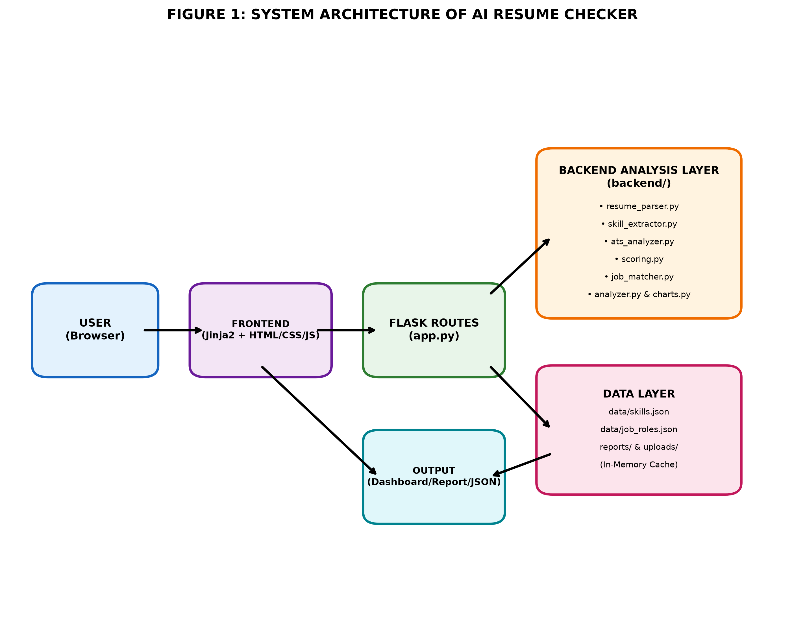
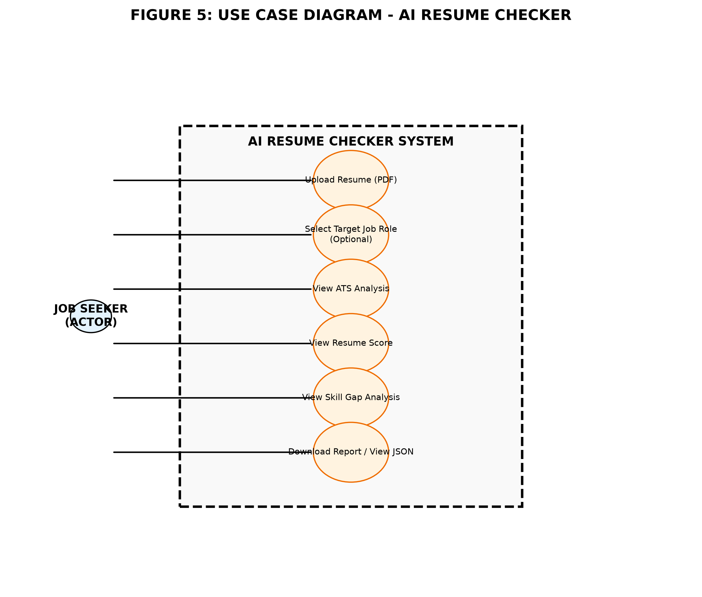
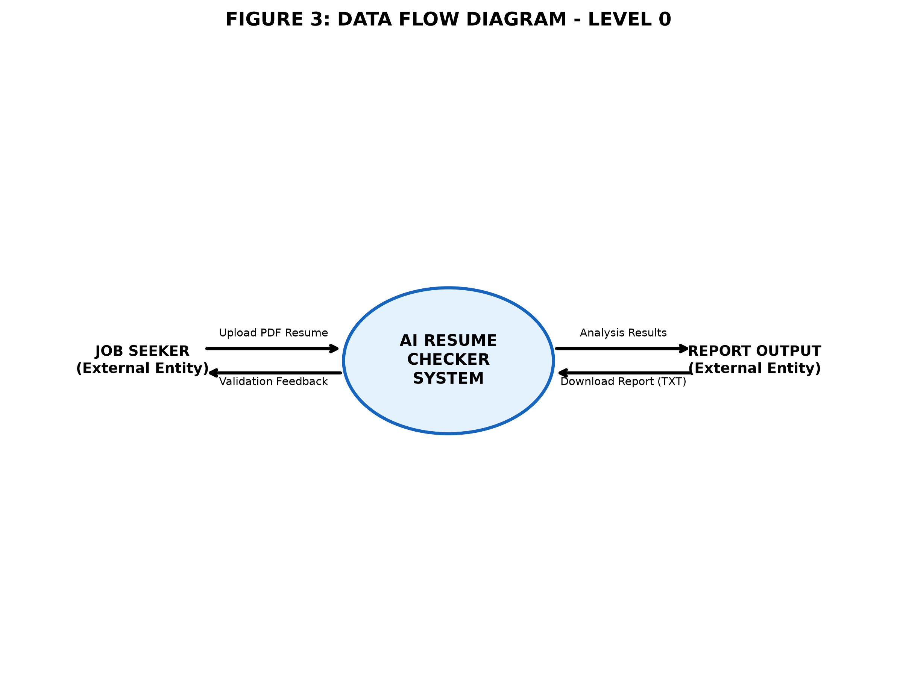
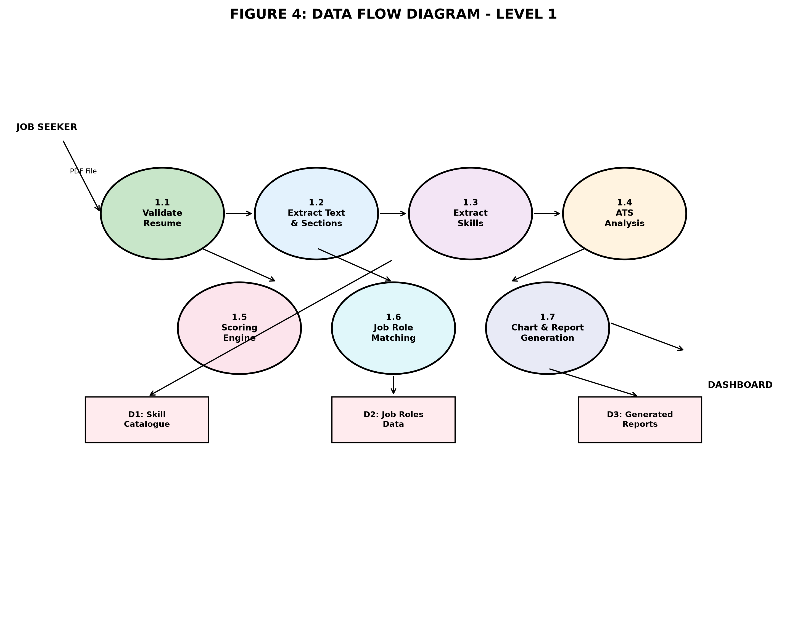
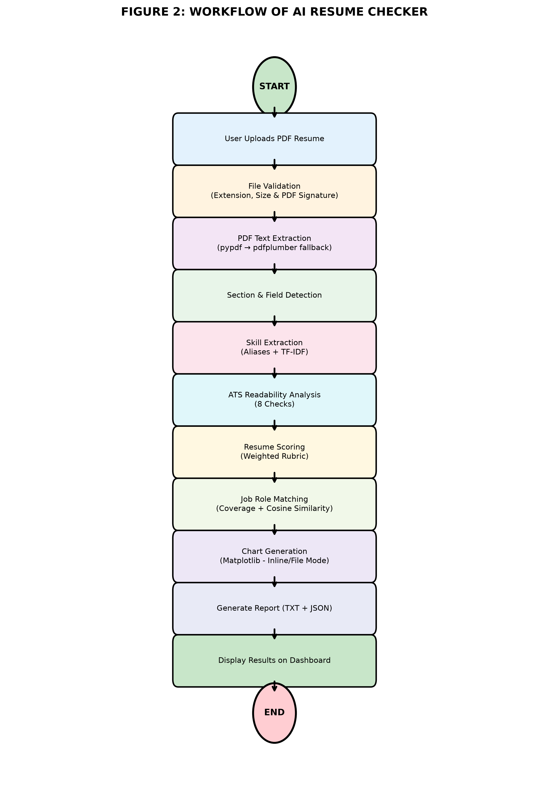

# CASE STUDY ON AI RESUME CHECKER

**An NLP-Based Resume Analysis and Job Matching System**

Submitted To: [FACULTY NAME]  
Submitted By: [STUDENT NAME] | UID: [YOUR UID]  
Programme: Master of Computer Applications (MCA)  
Department: Department of Computer Applications  
University: Chandigarh University  
Academic Session: 2026–2028  
Semester: [1st/2nd/etc.]  
Date: [DATE OF SUBMISSION]

---

## TABLE OF CONTENTS

- [1. INTRODUCTION](#1-introduction)
- [2. OBJECTIVES OF THE CASE STUDY](#2-objectives-of-the-case-study)
- [3. ORGANIZATION PROFILE](#3-organization-profile)
- [4. PROBLEM STATEMENT](#4-problem-statement)
- [5. EXISTING SYSTEM VS PROPOSED SYSTEM](#5-existing-system-vs-proposed-system)
- [6. SYSTEM ANALYSIS](#6-system-analysis)
- [7. SYSTEM DESIGN](#7-system-design)
- [8. IMPLEMENTATION DETAILS](#8-implementation-details)
- [9. TESTING AND VALIDATION](#9-testing-and-validation)
- [10. ADVANTAGES, LIMITATIONS & APPLICATIONS](#10-advantages-limitations--applications)
- [11. CONCLUSION](#11-conclusion)
- [12. FUTURE SCOPE](#12-future-scope)
- [13. BIBLIOGRAPHY](#13-bibliography)
- [14. APPENDIX](#14-appendix)

---

## 1. INTRODUCTION

In today's highly competitive job market, the first hurdle that a job seeker has to cross is not the interview, but the automated screening of their resume. Majority of the organisations make use of Applicant Tracking Systems (ATS) to filter thousands of resumes based on keywords, formatting, structure and relevance to the job description. 

Due to this, a highly qualified candidate can get rejected just because their resume does not match the criteria of the ATS. This creates a huge gap between the candidate and the opportunity. 

**AI Resume Checker** is a web-based application developed to bridge this gap. It acts as a personal ATS simulator that analyses, evaluates and provides constructive feedback to the job seeker regarding their resume. The system uses deterministic Natural Language Processing (NLP) techniques to check for readability, skills, structure, and job role compatibility, without making use of any third-party Large Language Models. 

---

## 2. OBJECTIVES OF THE CASE STUDY

The main objectives of this case study are: 

1. To study the need and importance of an automated resume evaluation system.
2. To analyse the working of the AI Resume Checker application.
3. To understand the system architecture, workflow and design of the project.
4. To identify the technologies used for the implementation of this system.
5. To examine the features, advantages and limitations of the proposed system.
6. To suggest realistic future enhancements for the system.

---

## 3. ORGANIZATION PROFILE

The AI Resume Checker is an academic project developed as a part of the MCA curriculum at the Department of Computer Applications, Chandigarh University. 

The project has been designed with the motive of providing a free, transparent and privacy focused solution to job seekers. Since it runs locally or on the user's own deployment, it does not require any user registration, database storage of personal resumes or any external API calls in its default configuration. This makes it ideal for students and freshers who require honest feedback on their resumes. 

---

## 4. PROBLEM STATEMENT

**"Lack of transparency in automated resume screening leads to qualified candidates being rejected due to formatting, missing keywords and poor ATS compatibility."**

Most commercial ATS checkers are either paid, require account creation, upload resumes to third-party servers or simply provide a vague percentage without any explanation. Job seekers have no way of knowing the exact reason behind a low score or what changes can be made to improve it. 

Thus, the problem that this project aims to solve is: *To develop a cost-free, explainable and privacy-preserving system that analyses a PDF resume against ATS standards and provides an actionable evaluation to the user.* 

---

## 5. EXISTING SYSTEM VS PROPOSED SYSTEM

**Table 1: Comparison between Existing System and Proposed System**

| **S.No.** | **Features** | **Existing Systems** | **Proposed System (AI Resume Checker)** |
| :--------: | :----------- | :-------------------: | :--------------------------------------: |
| 1. | **Transparency** | Mostly opaque. Only a final score is displayed. | Fully transparent. Every check, weight and rule is explained. |
| 2. | **Privacy** | Resumes are uploaded to third-party servers. | Runs locally or on user's own deployment. No resume data is shared externally. |
| 3. | **Cost** | Majority are freemium or fully paid. | Completely free to use. |
| 4. | **Deterministic Results** | Results may vary on each run due to AI models. | Fully deterministic. Same resume gives same result every time. |
| 5. | **Job Role Matching** | Either absent or very generic. | Compares resume against 10 different job roles using Coverage & Cosine Similarity. |
| 6. | **Offline Usability** | Not possible. | Can be run completely offline with no internet connection. |
| 7. | **Explainable Feedback** | Minimal or none. | Provides strengths, gaps, ATS checks and suggestions for improvement. |
| 8. | **No Database Dependency** | Most require user logins and databases. | Completely database-less. Uses in-memory caching and file-based storage only when writable. |

---

## 6. SYSTEM ANALYSIS

### 6.1 Functional Requirements

- The system must allow the user to upload a PDF resume only.
- The system must validate the file extension, size (max 4MB) and PDF signature.
- The system must extract text from the uploaded resume.
- The system must detect resume sections (Education, Experience, Projects, Skills, Certifications etc.).
- The system must extract technical and soft skills using a curated vocabulary.
- The system must perform 8-point ATS readability checks.
- The system must calculate an overall weighted resume score.
- The system must provide job role matching for the user.
- The system must generate visual charts, a downloadable text report and a JSON API.

### 6.2 Non-Functional Requirements

| **Requirement** | **Description** |
| :-------------- | :-------------- |
| **Usability** | Simple and user-friendly interface that can be used by anyone with basic computer knowledge. |
| **Reliability** | The system should not crash even if a chart fails to generate or if the report is missing. |
| **Security** | File validation is performed at every step. Uploaded files are not served publicly. |
| **Performance** | Analysis is completed within a few seconds for a standard one-page resume. |
| **Portability** | Can run on Windows, Linux, macOS and can be deployed on platforms like Vercel. |
| **Privacy** | No personal data is stored in any external database or sent to third-party services. |

### 6.3 Feasibility Study

- **Technical Feasibility:** All technologies used (Flask, Python, scikit-learn, Matplotlib) are open-source, lightweight and easy to integrate. 
- **Economic Feasibility:** The project is developed using free tools and libraries, hence has zero development cost.
- **Operational Feasibility:** The system is easy to operate, requires minimal resources and is ideal for end-users with no technical expertise. 

---

## 7. SYSTEM DESIGN

### 7.1 System Architecture

The AI Resume Checker follows a layered architecture, separating the frontend, backend logic and data layer for better modularity and maintainability. 



**Figure 1: System Architecture of AI Resume Checker**

- **User (Browser):** The interface through which the job seeker interacts with the system.
- **Frontend (Jinja2 + HTML/CSS/JS):** Handles the upload form, theme toggle, and displays the results in a clean dashboard.
- **Flask Routes (app.py):** Acts as the controller. It validates requests, routes them to the appropriate modules and handles errors.
- **Backend Analysis Layer:** The core of the system. Contains modules for parsing, skill extraction, ATS analysis, scoring, job matching and chart generation.
- **Data Layer:** Consists of JSON files for skills and job roles, along with temporary storage for reports and uploads.
- **Output:** Displays the final analysis in the form of a dashboard, downloadable text report and JSON response.

### 7.2 Use Case Diagram

The use case diagram represents the interaction between the user and the system. 



**Figure 2: Use Case Diagram of AI Resume Checker**

The only actor in the system is the **Job Seeker**. The actor can perform the following actions: upload a resume, optionally select a target job role, view ATS analysis, view resume score, view skill gap analysis and download the report or view the JSON output.

### 7.3 Data Flow Diagram (DFD)

#### 7.3.1 Level 0 DFD

Level 0 DFD shows the interaction between the external entity and the entire system as a single process. 



**Figure 3: Data Flow Diagram - Level 0**

Here, the job seeker uploads their PDF resume to the AI Resume Checker system. The system processes it and returns the analysed results and a downloadable report back to the job seeker.

#### 7.3.2 Level 1 DFD

Level 1 DFD gives a detailed view by breaking down the system into its sub-processes and data stores.



**Figure 4: Data Flow Diagram - Level 1**

The resume goes through processes such as validation, text extraction, skill extraction, ATS analysis, scoring, job role matching and finally chart & report generation. The system uses the Skill Catalogue (D1), Job Roles Data (D2) and stores generated reports (D3) during the process.

### 7.4 System Workflow

The complete flow of the system from upload to result is shown below: 



**Figure 5: Workflow Flowchart of AI Resume Checker**

**Step-wise Explanation:**

1. **Start:** User initiates the process by visiting the web application.
2. **Upload:** User uploads their resume in PDF format.
3. **Validation:** System checks for valid extension, file size and PDF file signature.
4. **Extraction:** Text is extracted using `pypdf`, and if insufficient, `pdfplumber` is used as a fallback.
5. **Detection:** Sections, fields, word count and page count are identified.
6. **Skill Extraction:** Skills are matched using the curated alias list and TF-IDF to identify relevant keywords.
7. **ATS Analysis:** 8-point checklist is run to check for ATS readability.
8. **Scoring:** A weighted scoring mechanism calculates the overall resume score.
9. **Job Matching:** Resume is compared against 10 job roles using skill coverage and cosine similarity.
10. **Visualization:** Matplotlib generates 8 different charts. 
11. **Report Generation:** A clean plain-text report and JSON output are created.
12. **Display:** Results are displayed on an interactive dashboard.
13. **End:** User can view, analyse or download their report.

---

## 8. IMPLEMENTATION DETAILS

### 8.1 Technology Stack

**Table 2: Technologies Used**

| **Technology** | **Purpose** |
| :------------- | :----------- |
| **Python 3.14** | Core programming language for backend logic and analysis. |
| **Flask 3.1** | Lightweight web framework to handle routing, requests and responses. |
| **pypdf** | Primary library for extracting text from PDF files. |
| **pdfplumber** | Fallback library to extract text from complex PDF layouts. |
| **scikit-learn** | Used for TF-IDF vectorization and Cosine Similarity calculation. |
| **NumPy** | Used for numerical computations during similarity checks. |
| **Matplotlib (Agg Backend)** | Used to generate statistical charts for the dashboard. |
| **Jinja2, HTML5, CSS3, JavaScript** | Used for building the frontend templates and interactivity. |
| **JSON** | Used to store the skill catalogue and job role definitions. |
| **Vercel** | Used for deploying the application with git-based auto-deploy. |

### 8.2 Module-Wise Implementation

**Table 3: Module Description**

| **Module** | **Description** |
| :---------- | :-------------- |
| **app.py** | Main application file. Handles routes (`/`, `/analyze`, `/results/<id>`, `/report/<id>`, `/api/report/<id>`), validation, storage and error handling. |
| **resume_parser.py** | Validates PDF signature, extracts text, detects sections and calculates word/page count. |
| **skill_extractor.py** | Extracts technical and soft skills using alias mapping and TF-IDF keyword detection. |
| **ats_analyzer.py** | Runs 8 deterministic ATS checks and returns pass/fail with explanations. |
| **scoring.py** | Applies weighted logic to generate component-wise and overall resume scores with grade bands. |
| **job_matcher.py** | Computes skill coverage and cosine similarity for all 10 job roles and ranks them. |
| **analyzer.py** | Acts as the orchestrator. Calls all modules in sequence and compiles the final result. |
| **charts.py** | Generates 8 charts (Score Breakdown, Skills, ATS Summary, Role Matching etc.). Supports both inline (base64) and file-based modes. |
| **skill_data.py** | Loads and validates the JSON files containing skills and job role data. |

### 8.3 Key Features Implemented

- **Smart PDF Validation:** Ensures only genuine PDF files are accepted by checking magic bytes.
- **Dual Text Extraction:** Uses `pypdf` first, switches to `pdfplumber` if extraction is insufficient.
- **Comprehensive Skill Detection:** Covers 164+ technical skills and 105+ aliases along with soft skills.
- **8-Point ATS Check:** Covers contact details, sections, length, formatting, keywords and more.
- **Weighted Scoring System:** Fair and explainable scoring based on multiple parameters.
- **Intelligent Job Matching:** Ranks job roles based on actual skill match and content similarity.
- **Data Visualisation:** Clean, colour-coded charts for easy interpretation.
- **Cross-Instance Resilience:** Uses browser `localStorage` to restore reports on serverless hosts.
- **Privacy-First Design:** No database, no tracking, and no external API usage.

---

## 9. TESTING AND VALIDATION

Testing was carried out throughout the development of the project to ensure correctness, reliability and robustness. A total of **152 automated tests** were executed and all of them passed successfully. 

**Table 4: Sample Test Cases**

| **Test Case ID** | **Test Scenario** | **Input** | **Expected Result** | **Actual Result** | **Status** |
| :--------------: | :----------------- | :-------- | :------------------- | :---------------- | :--------: |
| TC-01 | Upload non-PDF file with .pdf extension | Renamed .txt file | Rejected with "Not a valid PDF" message | Same as expected | **PASS** |
| TC-02 | Upload empty/corrupt PDF | Corrupted PDF bytes | Error: "Empty or unreadable PDF" | Same as expected | **PASS** |
| TC-03 | Valid PDF Upload | Standard formatted resume | Successful extraction of text | Text extracted correctly | **PASS** |
| TC-04 | Section Detection | Resume with standard headings | All major sections identified | Detected accurately | **PASS** |
| TC-05 | Skill Extraction | Resume with known skills/aliases | Correct skills listed | Listed correctly | **PASS** |
| TC-06 | ATS Analysis | Valid resume | 8 checks with pass/needs-attention | All 8 checks displayed | **PASS** |
| TC-07 | Resume Scoring | Valid resume | Score between 0-100 with grade | Within range | **PASS** |
| TC-08 | Job Role Matching | Resume with relevant skills | Roles ranked by relevance | Ranking shown correctly | **PASS** |
| TC-09 | Chart Generation (Inline Mode) | Vercel environment simulation | Base64 data URIs generated | Generated successfully | **PASS** |
| TC-10 | Report Restoration | Corrupted/missing server copy | Restore via browser storage | Restored successfully | **PASS** |

---

## 10. ADVANTAGES, LIMITATIONS & APPLICATIONS

### 10.1 Advantages

- **Free of Cost:** No charges for analysing any number of resumes.
- **Explainable AI:** Unlike black-box tools, every result is backed by a rule.
- **Privacy Oriented:** User's resume never leaves their control.
- **Time Saving:** Instant analysis within seconds.
- **Educational Value:** Helps students learn ATS patterns before applying.
- **Deployment Friendly:** Works seamlessly on both local and serverless environments.
- **No Login Required:** Completely hassle-free experience.

### 10.2 Limitations

- **No OCR Support:** Scanned or image-based PDFs cannot be parsed as the system extracts only selectable text.
- **Limited Job Catalogue:** Currently supports only 10 pre-defined job roles.
- **No Multi-Resume Comparison:** Only one resume can be analysed at a time.
- **Heuristic Based:** The scoring is rule-based and cannot replicate every company's custom ATS.
- **English Focused:** Primarily designed for English resumes.

### 10.3 Applications

- **For Students & Freshers:** Ideal for checking college resumes before campus placements.
- **For Job Seekers:** Helps in improving resumes before applying to online job portals.
- **For Career Guidance Cells:** Can be used in training sessions to educate students about ATS.
- **For Self-Learning:** Acts as a great reference project to understand NLP and Flask integration.
- **For Educational Use:** Can be demonstrated in MCA project exhibitions. 

---

## 11. CONCLUSION

The **AI Resume Checker** successfully achieves its objective of providing an honest, transparent and privacy-focused resume evaluation system. It effectively simulates the working of an Applicant Tracking System by analysing resumes on the basis of structure, skills, readability and job relevance. 

By combining text extraction, deterministic NLP, scoring logic and data visualisation, the system gives the user practical and actionable feedback. The most notable aspect of this project is its explainability, as the user is not just told a score, but also shown *why* they got it and *what* can be improved. 

Being database-less, offline-capable and fully testable, this project proves to be a reliable and efficient solution for the problem stated. Overall, this case study highlights how a simple, rule-based approach can be both powerful and user-friendly for solving a real-world problem.

---

## 12. FUTURE SCOPE

Although the current system is fully functional, there is still room for improvement. The following enhancements can be considered in the future: 

1. **OCR Integration:** Implement OCR (e.g., Tesseract) to support scanned/image-based resumes.
2. **Expanded Job Database:** Add more job roles across diverse domains like Data Science, Cybersecurity and Marketing.
3. **AI-Based Suggestions:** Provide smarter, rephrased suggestions for bullet points while keeping it deterministic.
4. **Multi-Language Support:** Extend support for resumes written in other regional languages.
5. **Resume Comparison:** Allow users to compare two versions of their resume side by side.
6. **ATS Keyword Optimizer:** Suggest missing high-impact keywords based on the selected job role.
7. **Mobile Application:** Develop a responsive mobile app for wider accessibility.
8. **Cloud Storage with User Control:** Optionally allow users to save history with full control and easy deletion.

---

## 13. BIBLIOGRAPHY

[1] Pallets Projects. *Flask Documentation*. [Online]. Available: [https://flask.palletsprojects.com/](https://flask.palletsprojects.com/)

[2] pypdf Developers. *pypdf Documentation*. [Online]. Available: [https://pypdf.readthedocs.io/](https://pypdf.readthedocs.io/)

[3] Jeremy Singer-Vine. *pdfplumber Documentation*. [Online]. Available: [https://github.com/jsvine/pdfplumber](https://github.com/jsvine/pdfplumber)

[4] scikit-learn Developers. *scikit-learn: Machine Learning in Python*. [Online]. Available: [https://scikit-learn.org/stable/](https://scikit-learn.org/stable/)

[5] Harris, C.R. et al., *Array programming with NumPy*, Nature, 585, 357–362 (2020), doi: [10.1038/s41586-020-2649-2](https://doi.org/10.1038/s41586-020-2649-2)

[6] Hunter, J.D. *Matplotlib: A 2D Graphics Environment*, Computing in Science & Engineering, 9, 90–95 (2007), doi: [10.1109/MCSE.2007.55](https://doi.org/10.1109/MCSE.2007.55)

[7] Manning, C.D., Raghavan, P., & Schütze, H. *Introduction to Information Retrieval*. Cambridge University Press, 2008.

[8] Turney, P.D. & Pantel, P. *From Frequency to Meaning: Vector Space Models of Semantics*. Journal of Artificial Intelligence Research, 37, 141–188, 2010. doi: [10.1613/jair.2930](https://doi.org/10.1613/jair.2930)

[9] Vercel Inc. *Vercel Documentation - Python*. [Online]. Available: [https://vercel.com/docs/functions/runtimes/python](https://vercel.com/docs/functions/runtimes/python)

[10] Silge, J. & Robinson, D. *Text Mining with R: A Tidy Approach*. O'Reilly Media, 2017.

---

## 14. APPENDIX

### APPENDIX A: Project Folder Structure

```text
Resume_Analyzer/
│
├── app.py
├── backend/
│   ├── analyzer.py
│   ├── ats_analyzer.py
│   ├── charts.py
│   ├── job_matcher.py
│   ├── resume_parser.py
│   ├── scoring.py
│   ├── skill_data.py
│   └── skill_extractor.py
├── data/
│   ├── job_roles.json
│   └── skills.json
├── public/static/
├── templates/
├── tests/
├── vercel.json
└── requirements.txt
```

### APPENDIX B: Sample Input

**Input:** A standard PDF resume containing sections like Contact Details, Profile Summary, Education, Technical Skills, Projects, Certifications and Languages.

### APPENDIX C: Sample Output

**Output Includes:**
- Overall Resume Score (e.g., 87/100) with Grade
- ATS Readability Report (8 Checks with Status)
- Extracted Skills List
- Top Matching Job Roles with Match %
- Strengths and Areas of Improvement
- Interactive Charts
- Downloadable `AI_Resume_Checker_Report_<id>.txt`
- JSON response via `/api/report/<id>`

### APPENDIX D: Diagrams Referenced

- Figure 1: System Architecture
- Figure 2: Use Case Diagram
- Figure 3: DFD Level 0
- Figure 4: DFD Level 1
- Figure 5: Workflow Flowchart

*(All diagrams are attached in the `docs/Case_Study_Images/` directory.)*
